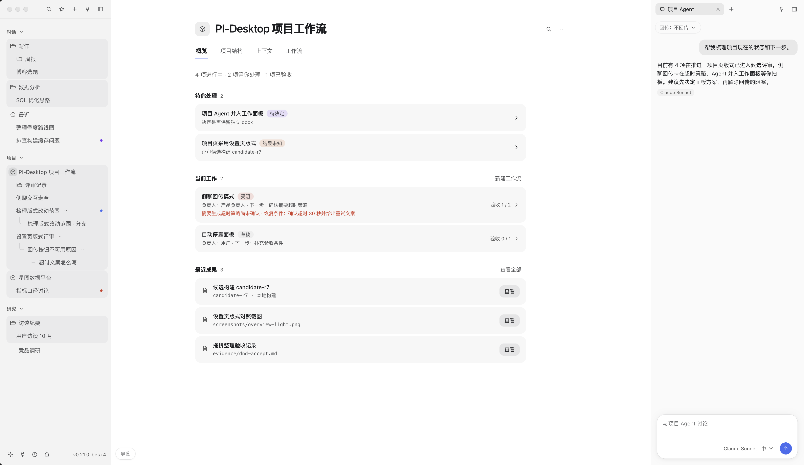
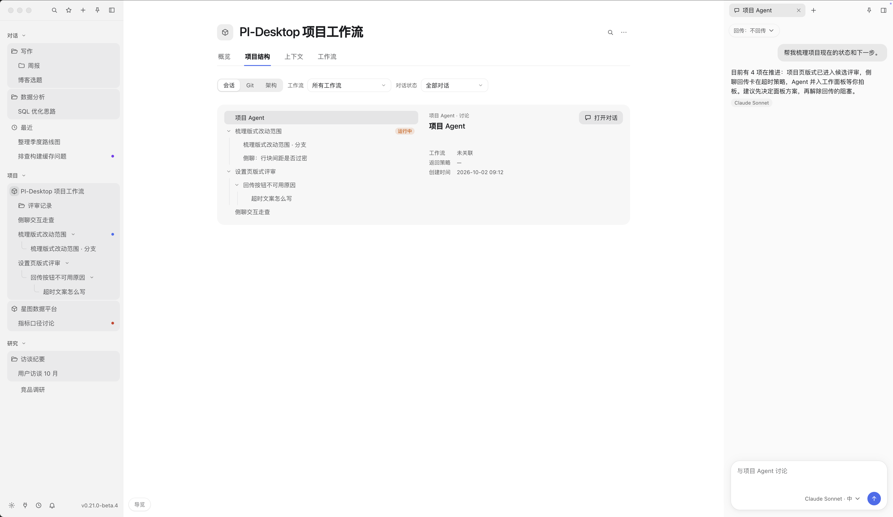
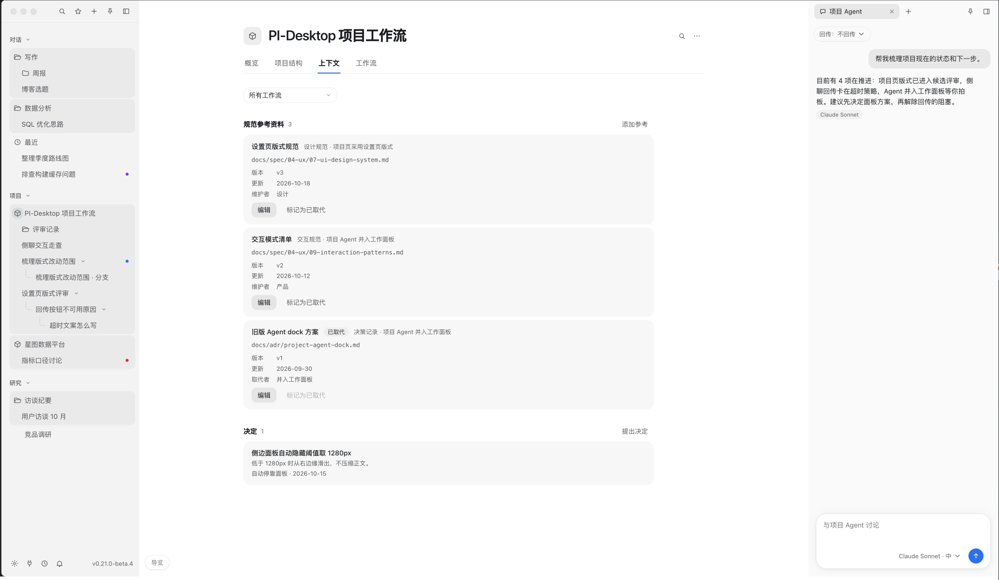
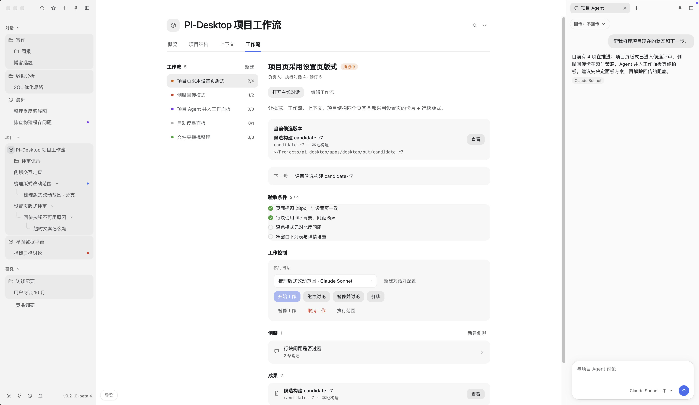
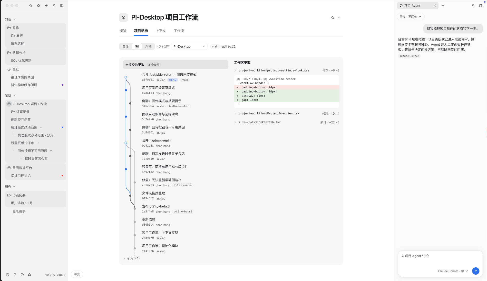
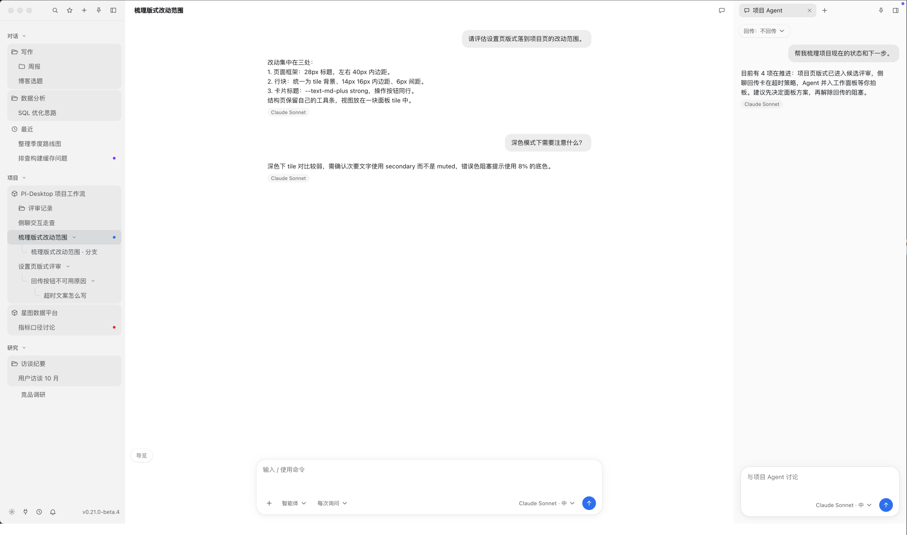

<div align="center">


# project-Pi

**A project-oriented AI agent workspace, built as a personal fork of [PI-Desktop](https://github.com/vastsa/PI-Desktop).**

[简体中文](README.zh-CN.md) · [Documentation](docs/README.md) · [Upstream project](https://github.com/vastsa/PI-Desktop)

</div>

project-Pi starts from a practical problem: work often outlives a single conversation. When using Codex and the original Pi, keeping track of a project’s goals, decisions, parallel work and results across sessions can require repeated explanation and manual handoffs. This fork explores a project-oriented workspace that keeps those pieces closer to the work itself.

**This is a development version, not a finished product.** Many capabilities and workflows still need refinement and real-world validation. The upstream releases and documentation describe PI-Desktop, not necessarily this fork.

## What is in this fork

- **Project workflow:** a project console and workstreams for organizing goals, progress, decisions, resources and execution alongside conversations. Workstreams can connect discussion, agent work and results without making a single chat the entire project.
- **Conversation and work:** project navigation, side conversations and paths between discussion and execution make it easier to return to ongoing work and inspect its context.
- **Agent workspace:** the PI-Desktop foundation provides sessions, model providers, permissions, plugins, skills, MCP integrations and agent delegation.
- **Richer responses:** visualization cards render interactive content in an isolated frame; LaTeX and Deep Research skills are bundled with the desktop application.

These features are evolving. Project execution runs while the local app is alive; persisted state supports reconciliation after restart, rather than an always-on cloud service. Availability and behavior can depend on the provider, environment and permissions.

## A project-oriented workspace

The following screenshots are from an interactive **demo**, using example data. They illustrate the direction of the project workspace; the current development build may differ and some functions still need work.

### See the project at a glance

The overview brings together decisions that need attention, active work and recent results, with the Project Agent available alongside the page.



### Navigate conversations and project structure

The project structure view groups related conversations and branches so it is easier to return to a particular line of work.



### Keep shared context visible

References and decisions have a place alongside the project, rather than being scattered across conversations.



### Follow a workflow from goal to result

The workflow view brings its candidate, acceptance criteria, work controls, related discussions and results together.



### Inspect project changes

The demo's Git view shows a history alongside workspace changes, placing code review in the project context.



### Discuss without losing the project

A conversation can sit beside the Project Agent, keeping discussion and project context within reach.



## Run from source

This fork's default branch is `development`. No fork-specific release package is promised; [upstream releases](https://github.com/vastsa/PI-Desktop/releases) are builds of the original project, not this development version.

Requirements: Node.js **22.19 or later**, pnpm **10 or later**, and a stable Rust toolchain.

```bash
git clone https://github.com/Silhouette-my/project-Pi.git
cd project-Pi
pnpm install
cargo build -p host-core
pnpm build:js
pnpm dev
```

Configure a model provider in the application, open a local project, and start a session or explore the project workspace. Remote model requests send the necessary context to the configured provider; review permissions before allowing an agent to modify files or run commands.

## Develop and validate

```bash
pnpm typecheck
pnpm lint
pnpm test
```

Choose checks appropriate to your change; see [Contributing](CONTRIBUTING.md) and [AGENTS.md](AGENTS.md). The repository includes [architecture and specifications](docs/spec/README.md), [ADRs](docs/adr/README.md), and a [plugin development guide](docs/plugin-development.md). Some documents record upstream behavior or historical plans: check the current implementation when using them for this fork.

## Upstream and license

project-Pi builds on [PI-Desktop](https://github.com/vastsa/PI-Desktop), which in turn uses the [pi](https://github.com/badlogic/pi-mono) ecosystem. Thanks to their contributors. This fork is independently developed and is not an official PI-Desktop release.

Licensed under the GNU Lesser General Public License v3.0; see [LICENSE](LICENSE).
