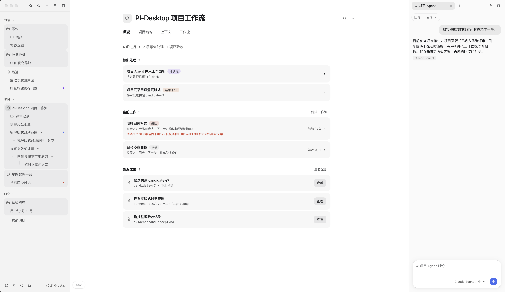
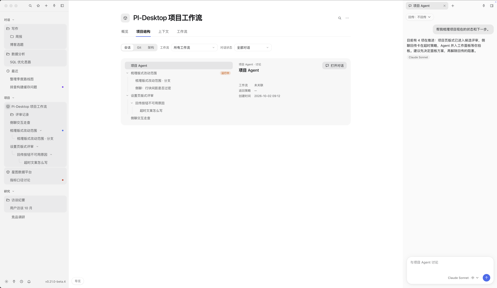
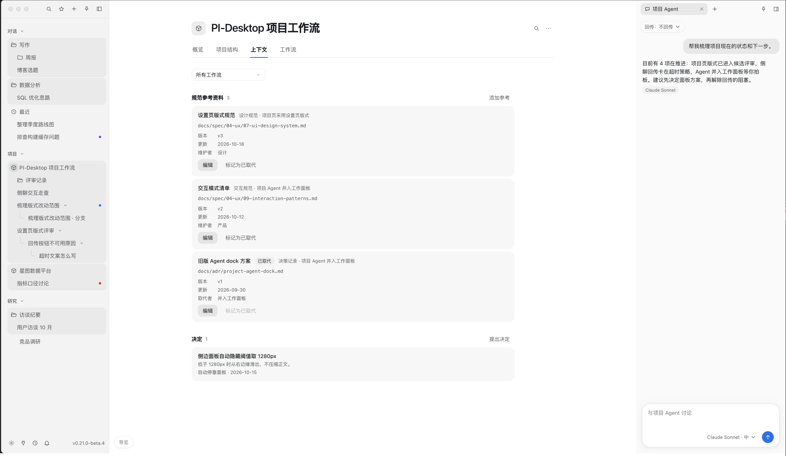
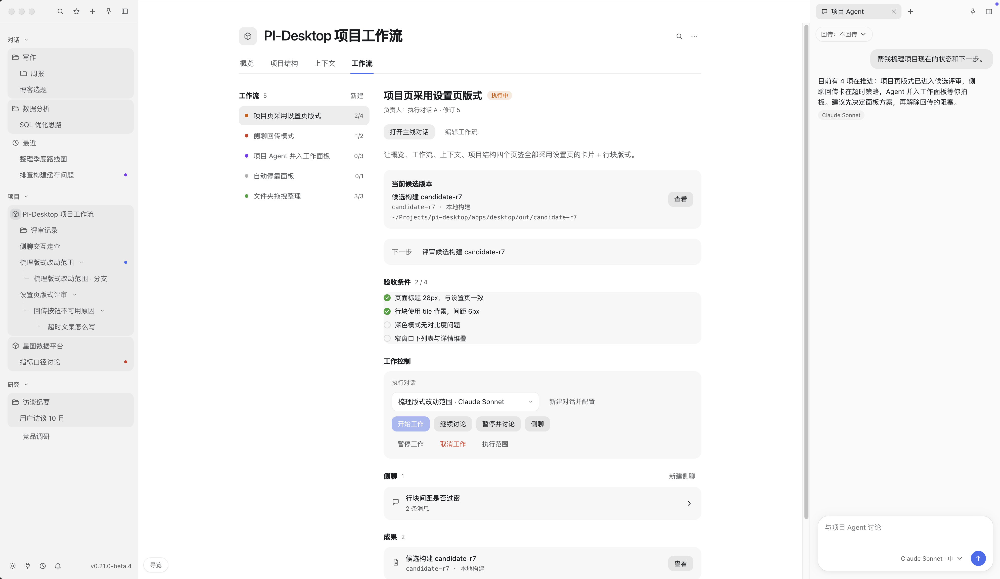
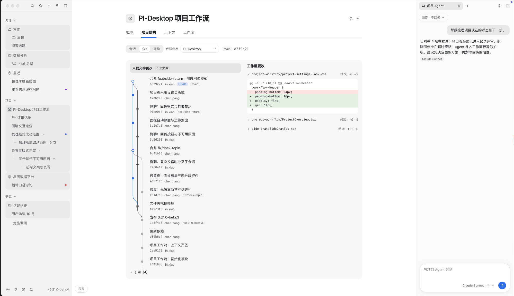
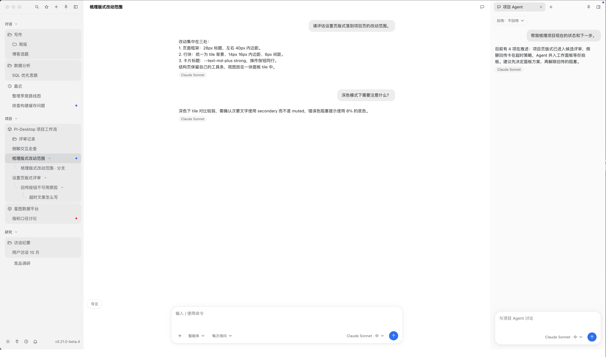

<div align="center">


# project-Pi

**以项目为中心的 AI Agent 工作台：基于 [PI-Desktop](https://github.com/vastsa/PI-Desktop) 的个人二次开发。**

[English](README.md) · [文档索引](docs/README.md) · [上游项目](https://github.com/vastsa/PI-Desktop)

</div>

project-Pi 的起点是一个实际问题：项目往往比一段对话更长。在使用 Codex 和原版 Pi 的过程中，跨会话追踪目标、决策、并行工作与结果，经常需要反复解释背景和手动交接。这个 fork 尝试以项目为中心，把这些信息和实际工作组织在一起。

**目前仍是开发版，不少功能和工作流有待完善，也需要更多真实使用验证。** 上游发布包和文档描述的是 PI-Desktop，不一定反映本 fork 的状态。

## 这个版本有什么

- **项目工作流**：通过项目控制台和工作流（workstream）组织目标、进展、决策、资源与执行，让项目不只依赖某一个聊天会话。
- **对话与工作衔接**：项目导航、侧边对话以及讨论与执行之间的入口，帮助回到持续进行的工作并查看上下文。
- **Agent 工作台**：保留 PI-Desktop 的会话、模型提供商、权限、插件、技能、MCP 和 Agent 委派等基础能力。
- **更丰富的回答**：可视化卡片在隔离的 frame 中展示交互内容；桌面应用内置 LaTeX 与 Deep Research 技能。

这些能力仍在演进。项目执行依赖本地应用运行；持久化状态用于重启后的状态核对，并非云端常驻服务。具体行为还取决于模型提供商、运行环境和权限设置。

## 以项目为中心的工作台

以下截图来自使用示例数据的交互式 **demo**，用于展示项目工作台的设计方向。当前开发版的界面和功能可能有所不同，部分能力仍待完善。

### 一眼了解项目状态

概览集中展示待处理事项、当前工作和最近成果，右侧可以同时与项目 Agent 讨论。



### 找回相关对话和项目结构

项目结构视图将相关对话及分支组织在一起，方便回到某一条工作线。



### 让共享上下文有处可查

参考资料和决策可以放在项目中查看，不必只在各段对话里寻找。



### 从目标跟进到成果

工作流视图将候选版本、验收条件、工作控制、关联讨论和成果放在一起。



### 在项目中查看代码变更

Demo 的 Git 视图将提交历史和工作区变更并排展示，让代码检查保留项目上下文。



### 在对话中继续讨论

对话与项目 Agent 可以并排显示，让讨论时仍能查看项目上下文。



## 从源码运行

本 fork 的默认分支是 `development`。目前不承诺提供独立发布包；[上游发布包](https://github.com/vastsa/PI-Desktop/releases)属于原项目，不包含此开发版的保证。

环境要求：Node.js **22.19 或更高版本**、pnpm **10 或更高版本**、稳定版 Rust 工具链。

```bash
git clone https://github.com/Silhouette-my/project-Pi.git
cd project-Pi
pnpm install
cargo build -p host-core
pnpm build:js
pnpm dev
```

启动后在应用中配置模型提供商、打开本地项目，即可开始会话或探索项目工作区。使用远程模型时，请求所需的上下文会发送给所配置的提供商；允许 Agent 修改文件或运行命令前，请检查权限设置。

## 开发与验证

```bash
pnpm typecheck
pnpm lint
pnpm test
```

按改动范围选择检查，参见[贡献指南](CONTRIBUTING.md)和 [AGENTS.md](AGENTS.md)。仓库还包含[架构与规范](docs/spec/README.md)、[架构决策记录](docs/adr/README.md)和[插件开发指南](docs/plugin-development.md)。其中部分文档记录上游行为或历史计划，在本 fork 中使用时请以当前实现为准。

## 上游与许可

project-Pi 基于 [PI-Desktop](https://github.com/vastsa/PI-Desktop) 开发，后者构建于 [pi](https://github.com/badlogic/pi-mono) 生态之上，感谢相关贡献者。本 fork 独立开发，并非 PI-Desktop 官方发布版。

项目采用 GNU Lesser General Public License v3.0，详见 [LICENSE](LICENSE)。
